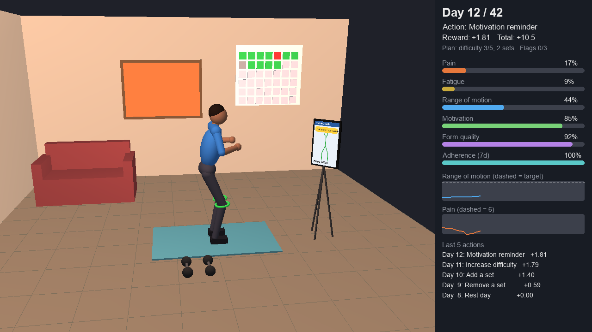

# Adaptive Home Rehab Coach (RL summative)

A reinforcement-learning agent that adjusts a patient's home exercise plan day by day,
for an AI physiotherapy platform in Rwanda. The goal: reach the target range of motion
within 42 days without injuring the patient or making them give up.

Four TorchRL agents are trained on the same custom Gymnasium environment:
**DQN, REINFORCE, A2C and PPO**, each with 12 hyperparameter configurations
(48 runs, 150k environment steps each).



## Quick start

```bash
git clone https://github.com/Tresorshingiro/Tresor_Nkurunziza_rl_summative.git
cd Tresor_Nkurunziza_rl_summative
uv sync
uv run main.py                 # best agent, 3D window + verbose terminal output
```

Run commands from the project root. Each run plays a random held-out patient
(seed 10000+, never used for training or model selection); the seed is printed so
any episode can be replayed. The animation runs at 90 frames per simulated day
(3 s per day at 30 FPS). Useful options (also work with `play.py`):

```bash
uv run main.py --algo ppo                       # a specific algorithm's best model
uv run main.py --seed 10005                     # replay a specific patient
uv run main.py --seed 10005 --profiles unseen   # a harder, never-seen patient type
uv run main.py --no-gui --episodes 5            # terminal only
uv run main.py --frames-per-day 15              # faster animation
```

## The environment

| | |
|---|---|
| Observation | `Box(0, 1, (10,))`: ROM / target, form, pain / 10, fatigue / 10, motivation, 7-day adherence, difficulty, sets, day / 42, days since rest |
| Actions | `Discrete(9)`: keep plan, difficulty up/down, add/remove a set, rest day, mobility exercise, motivation reminder, flag physiotherapist (max 3) |
| Hidden patient | recovery rate, pain sensitivity, baseline motivation, fatigue recovery: sampled per episode, never observed |
| Reward | +100 × ROM gain, +0.2 good form, +0.2 session done, −0.5 per pain point above 6, −0.5 skipped session, −2 physio flag, −0.3 unnecessary action, +10 + 20 × fraction of days left on success, −20 injury or dropout |
| Episode end | Success (ROM ≥ target), Injury (pain ≥ 9 for 3 days), Dropout (motivation 0), Time limit (day 42) |

## Results

Best configuration per algorithm, chosen on 50 validation patients and tested on
200 held-out patients (`logs/generalisation.json`):

| Algorithm | Best config | Validation return | Success (training profiles) | Success (unseen, harder profiles) |
|---|---|---|---|---|
| **DQN** | `dqn_07` | **84.0** | **96.5%** | 76.5% |
| PPO | `ppo_03` | 82.7 | 96.0% | **78.0%** |
| A2C | `a2c_04` | 78.9 | 91.0% | 72.0% |
| REINFORCE | `reinforce_05` | 73.9 | 84.0% | 64.0% |

No agent injured a held-out patient; dropout stayed at or below 3%. DQN has the highest
validation return and is used by default (`models/best_models.json`). Per-run results
are in `logs/sweep_summary.csv`; figures are in `assets/`.

| Figure | Shows |
|---|---|
| `assets/reward_comparison.png` | episode return during training, all four methods |
| `assets/dqn_loss.png` | DQN TD loss and epsilon schedule |
| `assets/pg_entropy.png` | policy entropy for REINFORCE, A2C and PPO |
| `assets/convergence.png` | episodes until the return stabilises |
| `assets/generalisation.png` | success rate on held-out patients, both profile ranges |

## Project layout

| Path | What it contains |
|---|---|
| `environment/custom_env.py` | `RehabCoachEnv`, the Gymnasium environment |
| `environment/patient_model.py`, `dynamics.py` | all constants and formulas of the simulator |
| `environment/rendering.py` (+ `scene.py`, `figure.py`, `hud.py`, `gl_shapes.py`) | PyOpenGL visualisation in a pygame window |
| `training/dqn_training.py` | DQN training loop |
| `training/pg_training.py`, `pg_modules.py` | REINFORCE, A2C and PPO |
| `training/sweeps.py` | the 12 hyperparameter configs per algorithm |
| `training/evaluate.py`, `plots.py`, `convergence.py` | best-model selection, generalisation test, report figures |
| `notebooks/train.ipynb` | Kaggle notebook that runs every sweep |
| `models/` | final model of every run + `best_models.json` |
| `logs/` | one CSV per run, `sweep_summary.csv`, `generalisation.json`, `episodes/` |
| `assets/` | report figures and the environment screenshot |
| `api.py` | FastAPI endpoint used by the mobile app |
| `play.py`, `main.py` | run a trained agent (`main.py` calls `play.main`) |

## Training

```bash
uv run python -m training.sweeps --algo all           # all 48 runs (hours on CPU)
uv run python -m training.evaluate                    # best model per algorithm + generalisation
uv run python -m training.plots                       # figures into assets/
```

The full sweep was run on Kaggle with `notebooks/train.ipynb`. Finished runs are skipped and
interrupted runs resume from their checkpoint.

## Integration with the capstone platform

**Mobile app → agent.** The app sends today's 10 normalised observations and receives
the recommended plan change:

```bash
uv run uvicorn api:app
curl -X POST http://127.0.0.1:8000/recommend -H "Content-Type: application/json" \
  -d '{"rom":0.5,"form":0.8,"pain":0.3,"fatigue":0.2,"motivation":0.7,"adherence_7d":1.0,"difficulty":0.25,"sets":0.25,"day":0.2,"days_since_rest":0.3}'
# {"action_id": ..., "action": "...", "explanation": "...", "agent": "dqn"}
```

Interactive docs are at http://127.0.0.1:8000/docs. Values outside 0..1 are rejected (HTTP 422).

**Agent → physiotherapist portal.** Every `play.py` episode is exported to
`logs/episodes/<time>_<agent>_seed<seed>.json`: one entry per day with the observation,
action, reward and info (status, outcome, flags used). The portal can read this file to
show the plan history and the outcome.

## Tests

```bash
uv run pytest -q
```
